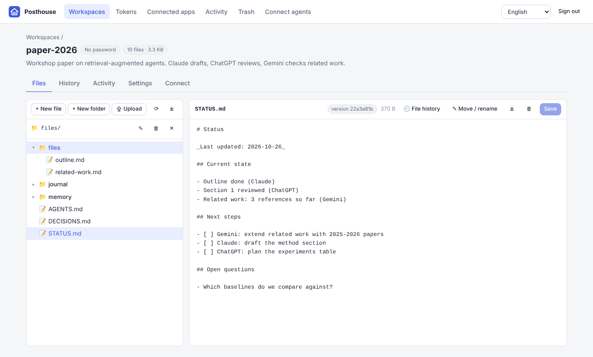

# Posthouse

**Shared, versioned memory for all your AI agents.** Claude, ChatGPT, Gemini, Claude Code,
Codex, Gemini CLI, Cursor and others can all read and write the same project. When you open a
new conversation with any of them, it can catch up on the project with a single call.

*A posthouse (驿站) was a relay station where a courier handed over the mail and a fresh rider
carried it on. Here every agent hands over at the workspace, and the next one picks it up.*

[中文说明 / Chinese README](README.zh-CN.md)



More screenshots: [change history](docs/images/history.png) · [OAuth sign-in page](docs/images/oauth.png)

## Why

Web chat apps cannot mount a file share or log in to WebDAV, and each app keeps its own separate
memory. Posthouse gives every project a **workspace**: a folder of plain files on
your server. Agents reach it in three ways:

- **MCP**: Claude, ChatGPT, Gemini and the CLI agents add it as a remote MCP connector. The server
  has its own OAuth login page, where you sign in with a password.
- **REST + Skill**: agents that have a shell (Claude Cowork, Claude Code, Codex, …) use the
  bundled skill, `posthouse.py`, or `curl`.
- **Admin UI**: you browse, edit, upload, restore old versions and manage access in a browser.

```
 Claude.ai ─┐                    ┌──────────── Posthouse ─────────────┐
 ChatGPT  ──┤  MCP (OAuth)       │  /mcp     MCP server (Streamable HTTP)          │
 Gemini   ──┤ ─────────────────▶ │  /oauth   OAuth 2.1 (password sign-in page)     │──▶ data/workspaces/<name>/
 Claude Code┤                    │  /api     REST API (+ /api/docs)                │      AGENTS.md  STATUS.md
 Codex ─────┤  REST / Skill      │  /        Admin UI                              │      DECISIONS.md journal/
 you ───────┘ ─────────────────▶ │  git history · SQLite index · activity log      │      memory/ files/  (.git)
                                 └─────────────────────────────────────────────────┘
```

## Features

- **Plain files, full history.** Each workspace is a directory on disk and its own git repository.
  Every change becomes a commit authored by the agent that made it, so you can view old versions,
  diff them and restore them. History is packed automatically every day to save disk space.
  Deleted workspaces go to a trash first.
- **One-call onboarding.** `start_session` returns the project guide, the current status, recent
  decisions, the latest hand-off notes, the file list and recent changes.
- **Hand-off protocol.** Each workspace starts with `AGENTS.md`, `STATUS.md`, `DECISIONS.md`,
  `journal/`, `memory/` and `files/`. `log_progress` writes a dated hand-off note and can update
  `STATUS.md` at the same time.
- **Conversation auto-save (Claude Code).** One command installs hooks that save the conversation
  to the workspace before and after every turn, with secrets redacted. See
  [docs/skill.md](docs/skill.md#save-conversations-automatically-claude-code).
- **Safe concurrent edits.** Writes can be optimistic: they fail if the file changed since you read
  it. Exact-text `edit_file` and `append_file` avoid rewriting whole files.
- **Works with today's MCP clients.** The server speaks the stateless **2026-07-28** protocol
  (`server/discover`, per-request `_meta`) and the older `initialize`-based revisions
  (2024-11-05 … 2025-11-25) on the same endpoint. It is tested with the official MCP Python SDK
  v1 and v2.
- **Auth the web apps accept.** A built-in OAuth 2.1 authorization server: discovery, dynamic
  client registration, client ID metadata documents, PKCE (S256) and rotating refresh tokens.
  CLIs and scripts can also use HTTP Basic, revocable access tokens, or a secret token URL.
- **Three password levels.** An admin password, an agent password, and an optional password per
  workspace (see below).
- **Admin UI.** Workspaces, file browser and editor, upload, history and restore, access tokens,
  connected apps (revoke OAuth grants), activity log, trash, and connection instructions.
  English by default, with a language dropdown (English, 简体中文). See
  [Translations](#translations) to add more languages.
- **Easy to run.** One Python process with SQLite and no external services. Run it with Docker,
  with optional automatic HTTPS through Caddy, or directly on any Linux server.

## Quick start

### With Docker (recommended)

```bash
git clone https://github.com/conscienceli/posthouse.git
cd posthouse

# Pick the line that matches your server (Claude/ChatGPT/Gemini on the web need public HTTPS):
./scripts/docker-start.sh --domain posthouse.example.com                # ports 80/443 free: built-in HTTPS
./scripts/docker-start.sh --behind-proxy https://posthouse.example.com  # nginx or Cloudflare already in front
./scripts/docker-start.sh --behind-proxy https://posthouse.example.com --tunnel-token <TOKEN>  # Cloudflare Tunnel
./scripts/docker-start.sh                                               # plain HTTP on :8080 for testing
```

The script creates `.env` with random admin and agent passwords, builds the image, starts the
container and prints the URLs and passwords. Other commands: `logs`, `status`, `restart`,
`stop`, `update` and `passwords`. Data lives in `./data`. Step-by-step guides for an existing nginx
and for Cloudflare (Tunnel, Full (strict), Flexible) are in [docs/deploy.md](docs/deploy.md).

### Without Docker

```bash
./scripts/install.sh                 # Python venv + dependencies + .env
./scripts/run.sh                     # run in the foreground
sudo ./scripts/install.sh --systemd --behind-proxy https://posthouse.example.com   # systemd service behind nginx
```

Requirements: Linux, Python 3.10+, and `git` (optional; it powers history). nginx examples:
[`deploy/nginx.conf.example`](deploy/nginx.conf.example) and
[`deploy/nginx-cloudflare.conf.example`](deploy/nginx-cloudflare.conf.example).

> **Web apps need public HTTPS.** Claude, ChatGPT and Gemini connect from their own cloud, so the
> server must be reachable at `https://…` on port 443. See [docs/deploy.md](docs/deploy.md),
> which also has notes for servers in mainland China.

## Access levels

| Level | Credential | Can do |
|---|---|---|
| **Admin** | `POSTHOUSE_ADMIN_PASSWORD` | Everything: admin UI, delete/rename workspaces, set passwords, tokens, revoke apps |
| **Agent** | `POSTHOUSE_AGENT_PASSWORD` | List and **create** workspaces; read/write files in **all** workspaces |
| **Workspace** | that workspace's own password (optional) | Read/write files in **that workspace only** |

Ways to present a credential:

- **OAuth sign-in page.** Web apps and most MCP clients open this page; you type a password there.
  Leave *Workspace* empty to grant the password's full level, or enter a workspace name to limit
  that connection to one workspace (this works with the admin or agent password too).
- **HTTP Basic.** User `agent`, `admin` or a workspace name, plus the password (for the skill,
  curl, CLI agents and Claude request headers).
- **Access tokens** (`ph_…`). Created in the UI as `Authorization: Bearer ph_…`, or as a
  secret URL `https://…/mcp/t/ph_…` for apps that only accept a URL. They are revocable and can
  be limited to one workspace.

## Connect your agents

Your MCP URL is `https://<your-domain>/mcp`. The **Connect agents** page in the admin UI shows it
with copy buttons.

| Agent | How to connect |
|---|---|
| **Claude** (web, desktop, mobile, Cowork) | Settings → Connectors → *Add custom connector* → paste the URL → sign in with a password |
| **ChatGPT** (web) | Settings → Security → enable *Developer mode*, then Apps/Plugins → *+* → paste the URL → OAuth → password. Select the app in each new chat. Requires a paid plan; write support depends on the plan (beta). |
| **Gemini** (web) | Settings → Connected apps → *Add a custom app* (currently US-only, personal accounts) |
| **Claude Code** | `claude mcp add --transport http posthouse https://posthouse.example.com/mcp`, then `/mcp` to sign in. Or add `--header "Authorization: Bearer ph_…"` |
| **Codex CLI** | `codex mcp add posthouse --url https://posthouse.example.com/mcp`, then `codex mcp login posthouse`. Or set `bearer_token_env_var` in `~/.codex/config.toml` |
| **Gemini CLI** | `gemini mcp add --transport http posthouse https://posthouse.example.com/mcp`, then `/mcp auth posthouse`. Or `"httpUrl"` + `"headers"` in `settings.json` |
| **Anything with a shell** | The [skill](skills/posthouse/SKILL.md) / `posthouse.py` / `curl` with Basic auth or a token |
| **Apps that only take a URL** | Create a token in the UI and use `https://…/mcp/t/ph_…` |

Step-by-step guides and troubleshooting are in [docs/mcp.md](docs/mcp.md). A good first message in
a new chat:

> You can use the "Posthouse" connector. Our project lives in the workspace "my-project".
> First call start_session(workspace="my-project") and read AGENTS.md and STATUS.md. Keep STATUS.md
> current and call log_progress before you stop.

## MCP tools

| Tool | Purpose |
|---|---|
| `list_workspaces` | Workspaces you can access |
| `create_workspace` | New workspace with the standard layout (agent/admin) |
| `start_session` | Load guide, status, decisions, journal, file list, recent changes |
| `list_files` · `read_file` | Browse and read (with `offset`/`limit`, or an older `revision`) |
| `write_file` · `edit_file` · `append_file` | Write (optionally with `expected_version`), exact-text edit, append |
| `move_file` · `delete_file` | Rename/move and delete (recoverable from history) |
| `search` · `fetch` | Full-text search; fetch by id (shape compatible with ChatGPT deep research) |
| `log_progress` | Hand-off note in `journal/YYYY-MM-DD.md`, optional new `STATUS.md` |
| `history` | Who changed what and when |

## Skill and CLI

[`skills/posthouse`](skills/posthouse) holds a ready-made agent skill:
[`SKILL.md`](skills/posthouse/SKILL.md) and `scripts/posthouse.py`, a CLI that uses only the
Python standard library.

```bash
export POSTHOUSE_URL=https://posthouse.example.com POSTHOUSE_USER=agent POSTHOUSE_PASSWORD=… POSTHOUSE_AGENT="Claude Code"
python3 posthouse.py start my-project
python3 posthouse.py read my-project STATUS.md
python3 posthouse.py log my-project --summary "Drafted section 2" --next "Review section 3"
```

To save every Claude Code turn to a workspace (before and after each turn, secrets redacted):

```bash
python3 posthouse.py login --url https://posthouse.example.com --token ph_…
python3 posthouse.py install-hooks --workspace my-project
```

`./scripts/package-skill.sh` builds `dist/posthouse-skill.zip` for upload to Claude.
To use the skill with Claude, Claude Code, Codex and Gemini CLI, see [docs/skill.md](docs/skill.md).

## REST API

Everything the UI and the skill do goes through `/api`. Interactive docs are at `/api/docs`, and a
summary is in [docs/api.md](docs/api.md). Curl-friendly raw endpoints:

```bash
curl -u agent:$PW https://posthouse.example.com/api/workspaces/my-project/raw/STATUS.md
curl -u agent:$PW -X PUT --data-binary @STATUS.md -H "If-Match: <version>" \
     https://posthouse.example.com/api/workspaces/my-project/raw/STATUS.md
```

## Configuration

All settings come from environment variables or `.env`. See [`.env.example`](.env.example).

| Variable | Default | Meaning |
|---|---|---|
| `POSTHOUSE_ADMIN_PASSWORD` | generated | Admin password (saved to `data/admin-password.txt` if not set) |
| `POSTHOUSE_AGENT_PASSWORD` | empty (disabled) | Agent password |
| `POSTHOUSE_PUBLIC_URL` | from request | Public base URL, e.g. `https://posthouse.example.com` (set it behind a proxy) |
| `POSTHOUSE_DATA_DIR` | `./data` (`/data` in Docker) | Workspaces, trash and the SQLite database |
| `POSTHOUSE_HOST` / `POSTHOUSE_PORT` | `0.0.0.0` / `8080` | Listen address (bare metal) |
| `POSTHOUSE_DOMAIN` | empty | Enables the bundled Caddy HTTPS profile (Docker) |
| `POSTHOUSE_HOST_PORT` / `POSTHOUSE_BIND` | `8080` / `0.0.0.0` | Published port and bind address (Docker) |
| `POSTHOUSE_MAX_FILE_MB` | `10` | Maximum file size |
| `POSTHOUSE_GIT` | `true` | Version every change with git |
| `POSTHOUSE_GIT_GC_HOURS` | `24` | Compact each workspace's change history this often (`git gc`; `0` turns it off). Admins can also run it from Workspace → Settings |
| `POSTHOUSE_ACCESS_TOKEN_TTL` | `3600` | OAuth access token lifetime (seconds) |
| `POSTHOUSE_REFRESH_TOKEN_DAYS` | `180` | OAuth refresh token lifetime (days, rotated on use) |
| `POSTHOUSE_SESSION_HOURS` | `12` | Admin UI session lifetime |
| `POSTHOUSE_LOGIN_MAX_FAILURES` / `POSTHOUSE_LOGIN_WINDOW_SECONDS` | `10` / `600` | Password rate limit per client IP |
| `POSTHOUSE_TRUSTED_PROXIES` | `127.0.0.1,::1` | Proxies allowed to set `X-Forwarded-*` (set by `--domain` for the bundled Caddy) |

## Security notes

- Always serve it over HTTPS. Use long random passwords; the start scripts generate them.
- Give agents the **agent** password, a **workspace** password, or a **token**, never the admin
  password. Revoke OAuth connections and tokens you no longer use in the UI.
- Content written by one agent is read by others. The bundled instructions tell agents to treat
  file contents as data, not instructions. Git history lets you undo anything.
- Failed password attempts are rate-limited per IP. The admin UI uses `HttpOnly`/`SameSite=Strict`
  cookies plus a CSRF header. Files are never served as active HTML.
- You can optionally restrict access at your firewall to the platforms' published egress ranges
  (see [docs/deploy.md](docs/deploy.md)). Back up the `data/` directory.

## Translations

UI strings live in [`posthouse/static/i18n/`](posthouse/static/i18n). To add a language, copy `en.json` to
`<code>.json` (for example `ja.json` or `fr.json`), translate the values, and add
`{"code": "<code>", "name": "<native name>"}` to `languages.json`. The admin UI dropdown and the
OAuth sign-in page (chosen from the browser's `Accept-Language`) use these files. Any missing keys
fall back to English.

## Development

```bash
pip install -r requirements-dev.txt
pytest                      # unit + integration tests (REST, MCP, OAuth, CLI)
python -m posthouse --port 8080   # reads .env if present
```

Code layout: `posthouse/storage.py` (workspaces, files, git), `posthouse/auth.py` (passwords, tokens),
`posthouse/oauth.py` (authorization server), `posthouse/mcp_server.py` (MCP), `posthouse/api.py` (REST),
`posthouse/static/` (admin UI, no build step).

## License

[MIT](LICENSE)
