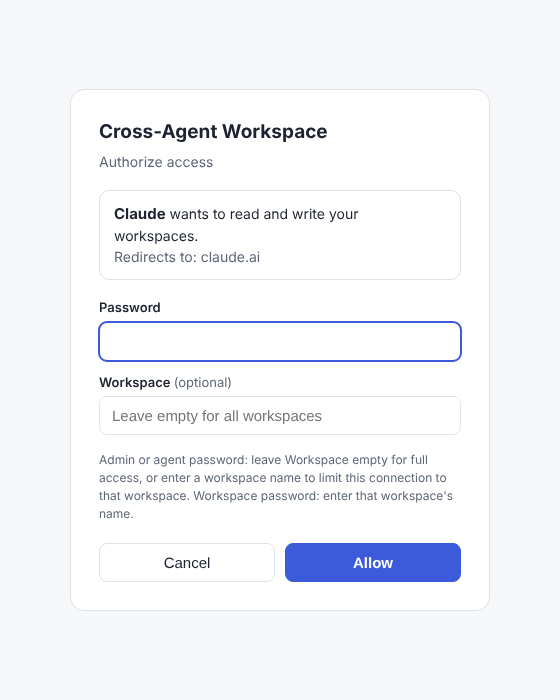

# Connecting agents over MCP

The MCP endpoint is `https://<your-domain>/mcp` (Streamable HTTP, JSON responses, no server-side
sessions). This page covers how to add it to each app, which authentication to choose, and what to
do when a connection fails.

> Platform menus change often. The steps below were checked in October 2026; if a menu has moved,
> look for "connectors", "apps", "MCP" or "custom app" in the app's settings.

## Choose an authentication method

| Method | Use it for | What you enter |
|---|---|---|
| **OAuth sign-in** (recommended) | Claude, ChatGPT, Gemini web apps; Claude Code, Codex, Gemini CLI | Just the URL. The app opens the server's sign-in page, where you enter a password (and optionally a workspace name to limit the connection) |
| **Bearer token / Basic auth header** | CLI agents, Cursor, scripts, Claude orgs with *request headers* (beta) | `Authorization: Bearer caw_…` or `Authorization: Basic base64(user:password)` |
| **Secret token URL** | Apps that accept only a URL with "no authentication" | `https://<domain>/mcp/t/caw_…` (create the token in the UI → Tokens) |



On the sign-in page, the password decides the access level: admin, agent, or a workspace's own
password. If you type a workspace name, the connection is limited to that workspace, even if you
signed in with the admin or agent password. Every connection shows up under **Connected apps** in
the admin UI, where you can revoke it.

**Change history.** Changes are recorded under the app's name: the OAuth client name (e.g.
"Claude"), the token name, or the `X-CAW-Agent` header if one is sent.

## Claude (claude.ai, Desktop, mobile, Cowork)

1. **Settings → Connectors → Add custom connector.** On Team/Enterprise plans, an Owner adds it
   under *Organization settings → Connectors*, and members then connect.
2. Name: `Cross-Agent Workspace`. URL: `https://<domain>/mcp`. Leave the OAuth fields empty.
   Claude registers itself automatically, either through a client ID metadata document or dynamic
   registration.
3. Click **Connect**. Enter your password on the sign-in page that opens.
4. In a chat, enable the connector from the **+ → Connectors** menu.

Free plans can add one custom connector. Claude connects from Anthropic's cloud
(`160.79.104.0/21`), so the server must be publicly reachable over HTTPS.

## ChatGPT (web)

1. **Settings → Security** (personal accounts): enable **Developer mode**. In workspaces, an admin
   enables it under *Settings → Apps → Advanced settings*.
2. Open **Apps / Plugins → +** (Add), paste `https://<domain>/mcp`, and keep authentication on
   **OAuth**.
3. Complete the sign-in page with your password.
4. In **each new conversation**, open **+ → Developer mode** and select the app.

Notes: custom MCP apps need a paid plan. OpenAI's documentation differs on whether Plus/Pro get
write tools or only read/fetch tools, so test a write first. Read tools are marked `readOnlyHint`,
so ChatGPT does not ask for confirmation on them; write tools ask for confirmation. ChatGPT
connects from OpenAI's published egress ranges (`https://openai.com/chatgpt-connectors.json`).

## Gemini (web)

**Settings → Connected Apps → Custom apps → Add a custom app**, then paste `https://<domain>/mcp`
and sign in. At the time of writing this needs a personal Google account, a US location, English
as the interface language, and *Keep Activity* turned on. Gemini asks you to confirm write actions.
Where custom apps are not available, use Gemini CLI, or let Gemini read a shared document and
paste its hand-off note into the workspace yourself.

## Claude Code

```bash
claude mcp add --transport http caw https://caw.example.com/mcp      # then run /mcp to sign in
# or with a token instead of OAuth:
claude mcp add --transport http caw https://caw.example.com/mcp --header "Authorization: Bearer caw_…"
```

## Codex CLI

```bash
codex mcp add caw --url https://caw.example.com/mcp
codex mcp login caw                        # OAuth sign-in in the browser
```

Or in `~/.codex/config.toml`:

```toml
[mcp_servers.caw]
url = "https://caw.example.com/mcp"
bearer_token_env_var = "CAW_TOKEN"          # export CAW_TOKEN=caw_…
http_headers = { "X-CAW-Agent" = "Codex" }
```

## Gemini CLI

```bash
gemini mcp add --transport http caw https://caw.example.com/mcp      # then: /mcp auth caw
```

Or in `~/.gemini/settings.json`:

```json
{
  "mcpServers": {
    "caw": {
      "httpUrl": "https://caw.example.com/mcp",
      "headers": { "Authorization": "Bearer caw_…", "X-CAW-Agent": "Gemini CLI" }
    }
  }
}
```

## Cursor, VS Code and other MCP clients

Most clients accept a URL plus headers, for example in Cursor's `.cursor/mcp.json`:

```json
{ "mcpServers": { "caw": { "url": "https://caw.example.com/mcp",
  "headers": { "Authorization": "Bearer caw_…" } } } }
```

Clients that support MCP OAuth can also connect with just the URL.

## Tools

| Tool | Arguments | Notes |
|---|---|---|
| `list_workspaces` | — | Only the workspaces your credential can access |
| `create_workspace` | `name`, `description?`, `password?` | Agent/admin only. Adds the standard layout |
| `start_session` | `workspace` | Markdown bundle: AGENTS.md, STATUS.md, latest decisions, last two journal files, file list, last 10 changes |
| `list_files` | `workspace`, `path?`, `recursive?` | |
| `read_file` | `workspace`, `path`, `offset?`, `limit?`, `revision?` | The first line has `version: …`, which you need for safe overwrites |
| `write_file` | `workspace`, `path`, `content`, `expected_version?`, `message?` | `expected_version: "new"` = create only |
| `edit_file` | `workspace`, `path`, `old_text`, `new_text`, `replace_all?`, `expected_version?` | `old_text` must match exactly once unless `replace_all` is set |
| `append_file` | `workspace`, `path`, `content` | Creates the file if missing |
| `move_file` | `workspace`, `source`, `destination`, `overwrite?` | Files or folders |
| `delete_file` | `workspace`, `path`, `recursive?` | Recoverable from history |
| `search` | `query`, `workspace?` | Returns `{results:[{id,title,url,text}]}` |
| `fetch` | `id` | `id` = `workspace/path` from `search` |
| `log_progress` | `workspace`, `summary`, `next_steps?`, `status?`, `agent?` | Appends to `journal/YYYY-MM-DD.md`; `status` replaces STATUS.md |
| `history` | `workspace`, `path?`, `limit?` | Commit list with authors and changed files |

A credential limited to one workspace may omit `workspace`; it defaults to that workspace.

## Protocol support

- **2026-07-28 (stateless).** Supports `server/discover`, per-request `_meta` protocol versions,
  `resultType`, and `ttlMs`/`cacheScope` on list results. Mismatched `MCP-Protocol-Version`,
  `Mcp-Method` or `Mcp-Name` headers are rejected with `-32020`. Unsupported versions get `-32022`
  with the supported list.
- **2025-11-25, 2025-06-18, 2025-03-26, 2024-11-05.** Uses the `initialize` handshake. No session
  id is issued; every request is independent.
- `GET /mcp` and `DELETE /mcp` return `405`. The server never sends server-initiated messages.
- **Authorization.** Supports RFC 9728 protected-resource metadata
  (`/.well-known/oauth-protected-resource/mcp`), RFC 8414 server metadata, RFC 7591 dynamic
  registration, client ID metadata documents (`client_id_metadata_document_supported`), PKCE S256
  only, the RFC 9207 `iss` parameter, rotating refresh tokens, and revocation.

## Troubleshooting

| Symptom | Likely cause / fix |
|---|---|
| "Couldn't reach the MCP server" | The URL is not public HTTPS on 443, there is a certificate problem, or a firewall blocks the platform's IP ranges. Run `curl -i https://<domain>/mcp`: it should return `401` with a `WWW-Authenticate` header |
| Sign-in page shows `http://` or a wrong host in links | Set `CAW_PUBLIC_URL=https://<domain>` in `.env` and restart. Behind your own proxy, also forward `X-Forwarded-Proto` |
| "Unknown client_id" on the sign-in page | The app's registration was purged or the server's data was reset. Remove and re-add the connector |
| Sign-in keeps failing | Wrong password, or more than 10 failures within 10 minutes (rate limit). Wait or restart the server |
| Tools appear but every call says "not found or not accessible" | The connection is limited to one workspace. Check **Connected apps** in the UI |
| ChatGPT shows old tools after an update | ChatGPT freezes tool definitions; refresh the app in its settings |
| A write fails with a version conflict | Another agent changed the file. Read it again and re-apply the change |
